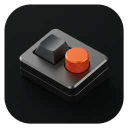

<div align="center">



# MeKPro

**Universal Mechanical Keyboard Configurator & Real-Time 3D Studio**  
*Konfigurator keyboard mechanical berbasis macOS untuk perangkat yang aplikasi resminya tidak lagi diperbarui atau hanya tersedia di Windows.*

[-black?style=flat-square&logo=apple)](https://github.com/ArahKarya/mekpro)
[-orange?style=flat-square&logo=rust)](https://tauri.app/)
[](https://vitejs.dev/)
[](LICENSE)

</div>

---

## Latar Belakang Masalah

Banyak produsen keyboard mechanical OEM (seperti Rexus, Royal Kludge, VortexSeries, Fantech, Ajazz) merilis produk dengan spesifikasi perangkat keras premium (gasket mount, rotary knob CNC, layar TFT, tri-mode connection). Namun, perangkat lunak resminya kerap mengalami kendala berikut:
- **Hanya tersedia untuk Windows**: Pengguna macOS tidak memiliki akses ke pengaturan debounce switch, layar TFT, maupun tombol makro.
- **Ditinggalkan oleh Brand**: Banyak aplikasi bawaan yang tidak lagi diperbarui, tidak kompatibel dengan arsitektur macOS modern, atau sulit ditemukan tautan unduhannya.
- **Bloatware & Telemetri**: Aplikasi pabrikan sering kali berukuran ratusan megabyte dan membebani memori sistem.

**MeKPro** dibangun sebagai utilitas native macOS berukuran ringan, responsif, dan independen dari cloud untuk mengonfigurasi keyboard mechanical langsung dari Mac Anda.

---

## Perangkat Pilot: Rexus Daxa M82X Ultimate

Aplikasi ini diuji dan dioptimalkan secara langsung dengan perangkat pilot fisik:
- **Model**: Rexus Daxa M82X Ultimate (`M82XU 5.0`)
- **Layout**: 75% Exploded (82 Keys) + Rotary Knob CNC + Layar TFT 0.85"
- **Vendor ID**: `0x25A7` (9639)
- **Product ID**: `0x2420` (9248)
- **Chipset Family**: Compx / Sino Wealth / Beken Tri-Mode Controller
- **Konektivitas**: Bluetooth 5.0 Low Energy, Kabel USB Type-C, dan 2.4GHz Wireless Dongle

---

## Fitur Utama

### 1. Visualisasi Keyboard 3D & Simulasi Pencahayaan RGB 60 FPS
- **Mode 2D & 3D**: Beralih bebas antara tampilan matriks 2D presisi untuk pemetaan tombol dan tampilan 3D isometrik dengan perspektif kedalaman sasis.
- **Simulasi Efek Cahaya Sebelum Terapkan**:
  - **Cyber Wave**: Gelombang warna dinamis dua arah atau dari tengah keluar.
  - **Reactive Thock (Ripple)**: Riak cahaya merambat keluar dari tombol fisik yang ditekan.
  - **Breathing & Spectrum**: Siklus spektrum penuh atau denyut transisi warna ganda.
  - **Static Per-Key**: Pewarnaan khusus per masing-masing tombol individual.
- **Kontrol Sudut Kamera 3D**: Pilihan preset sudut pandang Isometrik, Sudut Ketik Meja, dan Fokus LED Bawah, dilengkapi slider kemiringan (tilt) dan rotasi (yaw).

### 2. Pemetaan Tombol Kernel Tanpa Batas (`IOHIDEventSystem`)
- **Latensi 0.0ms**: Pemetaan tombol langsung dieksekusi di level kernel macOS melalui `hidutil` tanpa proses perantara yang memperlambat input.
- **Isolasi Per-Perangkat**: Pemetaan hanya berlaku khusus untuk `VendorID:ProductID` keyboard target dan tidak memengaruhi keyboard bawaan MacBook.
- **Mac Modifier Swap**: Menukar fungsi tombol Windows dan Alt menjadi Command dan Option dalam satu klik.
- **Rotary Knob Press**: Menetapkan aksi tombol tekan knob (Mute, Play/Pause, Mission Control, Kunci Layar).
- **Auto-Apply Login**: Opsi membuat LaunchAgent lokal (`~/Library/LaunchAgents/com.aks.mekpro.remap.plist`) agar pemetaan tetap aktif setiap kali Mac dinyalakan ulang.

### 3. Otomasi Makro & Peluncur Pintasan
- Mendukung tipe aksi:
  - **Text Snippet**: Mengetikkan teks atau template secara otomatis.
  - **App Launcher**: Membuka aplikasi macOS yang sering digunakan (contoh: Terminal, IDE, Browser).
  - **Shell Command**: Menjalankan skrip shell di latar belakang.
  - **System Action**: Tangkapan layar area, Mission Control, atau kunci layar.

### 4. Penguji Matriks Tombol, NKRO & Detektor Chatter
- **Max NKRO Tracker**: Menghitung jumlah tombol maksimum yang sanggup dikirim bersamaan.
- **Switch Chatter Detector**: Mendeteksi sinyal tombol yang memantul ulang dalam interval kurang dari 25ms untuk menandai switch mekanikal yang mulai aus atau kotor.
- **Coverage Map**: Menandai keycap yang sudah teruji saat ditekan.

### 5. Editor Kanvas Layar TFT 16x16 (RGB565) & RTC Sync
- Kanvas piksel interaktif 16x16 untuk mendesain ikon khusus pada layar TFT keyboard.
- Pilihan palet warna dan preset ikon siap pakai (Robot, Switch, Heart).
- Sinkronisasi jam sistem macOS (Real Time Clock) ke layar TFT perangkat.

### 6. Cadangan & Pemulihan Format JSON Terbuka
- Seluruh konfigurasi profil disimpan dalam file JSON terbuka (`.mekpro.json`) yang mudah dicadangkan, dibagikan, atau diedit secara manual.

---

## Arsitektur Konektivitas: Hybrid BLE & USB

| Fitur | Bluetooth Low Energy | Kabel USB / 2.4GHz Dongle |
| :--- | :---: | :---: |
| Pemetaan Tombol (Kernel Remap) | Aktif Langsung | Aktif Langsung |
| Mac Option / Command Swap | Aktif Langsung | Aktif Langsung |
| Otomasi Makro & Pintasan | Aktif Langsung | Aktif Langsung |
| Penguji Matriks, NKRO & Chatter | Aktif Langsung | Aktif Langsung |
| Simulasi RGB & Visual 3D di Layar | Aktif Langsung | Aktif Langsung |
| Flash RGB ke EEPROM Hardware | Disimpan ke Antrean | Ditransmisikan Langsung (64B Report 0x04) |
| Konfigurasi Debounce Switch MCU | Disimpan ke Antrean | Ditransmisikan Langsung (64B Report 0x05) |
| Flash Gambar Layar TFT & Jam RTC | Disimpan ke Antrean | Ditransmisikan Langsung (64B Report 0x08) |

> **Catatan Firmware Perangkat**: Mode Bluetooth Low Energy (HOGP) pada chip keyboard nirkabel OEM membatasi `MaxFeatureReportSize = 1 byte` guna menghemat daya baterai. Oleh karena itu, pengiriman paket konfigurasi 64-byte ke chip internal keyboard secara teknis memerlukan sambungan kabel USB atau dongle 2.4GHz. MeKPro menyimpan pengaturan tersebut secara otomatis saat Anda berada di mode Bluetooth dan langsung menerapkannya begitu kabel USB terhubung.

---

## Struktur Repositori

```text
mekpro/
├── DESIGN.md                   # Spesifikasi desain industri dan palet warna
├── anti-slop/                  # Laporan audit kualitas dan aksesibilitas
├── index.html                  # Struktur antarmuka dan modal dialog native
├── package.json                # Konfigurasi dependensi frontend
├── src/
│   ├── layout_m82xu.ts         # Definisi fisik matriks 82 tombol, koordinat, dan hid usage
│   ├── main.ts                 # Logika interaktif, mesin simulasi RGB 60 FPS, dan kamera 3D
│   └── styles.css              # Sistem token tema gelap/terang dan efek 3D keycap
└── src-tauri/
    ├── Cargo.toml              # Dependensi Rust (tauri, hidapi, core-graphics)
    ├── tauri.conf.json         # Konfigurasi bundel native macOS
    ├── icons/                  # Master ikon aplikasi dan bundel multi-resolusi
    └── src/
        ├── hid_protocol.rs     # Penyusun frame 64-byte Vendor HID 0x25A7 dan transmiter hidapi
        ├── listener.rs         # Event tap macOS (CGEventTap) untuk mendengarkan tombol fisik
        ├── models.rs           # Struktur data profil, remap, RGB, dan TFT
        ├── remap_engine.rs     # Eksekutor hidutil IOHIDEventSystem dan pembuat LaunchAgent
        ├── scanner.rs          # Pendeteksi perangkat keyboard pada bus HID macOS
        └── storage.rs          # Penyimpan profil lokal (~/Library/Application Support/com.aks.mekpro/)
```

---

## Panduan Instalasi & Pengembangan

### Prasyarat
- Komputer Mac dengan macOS 12 (Monterey) atau versi lebih baru.
- [Node.js](https://nodejs.org/) v18+ dan [pnpm](https://pnpm.io/).
- [Rust](https://www.rust-lang.org/) toolchain (disarankan via `rustup`).

### Menjalankan dalam Mode Pengembangan

```bash
# Clone repositori
git clone https://github.com/ArahKarya/mekpro.git
cd mekpro

# Pasang dependensi JavaScript
pnpm install

# Jalankan dalam mode pengembangan interaktif
pnpm tauri dev
```

### Membuat Paket Bundel Native macOS (`.app`)

```bash
# Kompilasi aplikasi biner macOS
pnpm tauri build --bundles app --debug

# Aplikasi siap dibuka di:
# src-tauri/target/debug/bundle/macos/MeKPro.app
open src-tauri/target/debug/bundle/macos/MeKPro.app
```

---

## Lisensi

Proyek ini didistribusikan di bawah lisensi [MIT](LICENSE). Dikembangkan oleh **Arah Karya Sinergi**.
